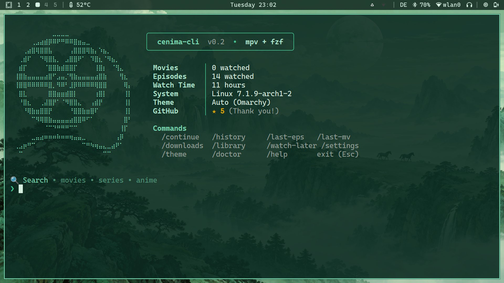

# cenima-cli

**Browse movies, series, and anime, play with mpv + fzf, and download safely from your terminal.**

An interactive Python CLI for catalog discovery, playback, managed downloads,
resume progress, and Arabic-friendly terminal use.

<p>
  <a href="LICENSE"></a>
  
  
</p>

Original author: [np4abdou1](https://github.com/np4abdou1)
Collaborator: [Abdelilah Elgallati](https://github.com/AbdelilahElgallati)

## Preview

<p align="center">
  
</p>

## Highlights

- Classic ASCII art welcome screen with native `fzf` picker (and `RichPicker` fallback)
- Movies, seasons, episodes, and latest-added catalogs
- Resume watching and recent watch history
- Managed offline library and Watch Later
- Built-in yt-dlp downloads, optional aria2c, and guarded IDM handoff
- Direct/HLS proxy with headers and range-aware resume
- FFprobe and disk-space completion safeguards
- Arabic and Unicode filename preservation
- Short commands, fuzzy title ranking, and keyboard-first navigation
- Redacted rotating diagnostics, settings export/import, and `/doctor`

## Installation

### Quick Install Script

**Linux / macOS:**

```sh
curl -fsSL https://raw.githubusercontent.com/np4abdou1/cenima-cli/main/install.sh | bash
```

**Windows (PowerShell):**

```powershell
irm https://raw.githubusercontent.com/np4abdou1/cenima-cli/main/install.ps1 | iex
```

Or from a cloned repository:

```sh
git clone https://github.com/np4abdou1/cenima-cli.git
cd cenima-cli
./install.sh
```

The installer creates an isolated virtual environment, installs `cenima-cli` with download support, links `cinema-cli` / `cenima-cli` / `cenima`, and checks for native tools (`mpv`, `fzf`, `ffmpeg`).

### Manual Setup

#### Windows

Install Python and mpv, then run:

```powershell
py -3 -m venv .venv
.\.venv\Scripts\python.exe -m pip install -e ".[download]"
mpv --version
cinema-cli
```

If scripts are not on `PATH`, launch directly:

```powershell
.\.venv\Scripts\cinema-cli.exe
```

### Linux

```sh
python3 -m venv .venv
.venv/bin/python -m pip install -e ".[download]"
sudo apt install mpv ffmpeg
.venv/bin/cinema-cli
```

### macOS

```sh
python3 -m venv .venv
.venv/bin/python -m pip install -e ".[download]"
brew install mpv ffmpeg yt-dlp
.venv/bin/cinema-cli
```

Native tools are not installed automatically. Use `/doctor` to check Python,
mpv, yt-dlp, FFmpeg, ffprobe, aria2c, config directory, and download directory.

## Run

From the repository root:

```powershell
python -m pip install -e ".[download]"
cinema-cli
```

Available launchers:

```text
cinema-cli
cenima-cli
cenima
python main.py
```

Check the version or environment without starting the TUI:

```text
cinema-cli --version
cinema-cli --doctor
cinema-cli --help
cinema-cli --export-settings <path>
cinema-cli --import-settings <path>
```

## Search and navigation

Search by title, select a result, then choose a season or episode. `Enter`
selects, arrow keys navigate, `/` filters the current list, and `Esc` or `b`
returns while in a menu. Inside text fields, `b` remains ordinary text.

| Command | Shortcut | Purpose |
| --- | --- | --- |
| `/history` | `/h` | Recent watch history |
| `/continue` | `/c` | Continue watching |
| `/library` | `/l` | Browse managed downloads |
| `/downloads` | `/d` | Queue, retry, cancel |
| `/watch-later` | `/wl` | Saved titles |
| `/last-eps` | `/le` | Latest episode additions |
| `/last-mv` | `/lm` | Latest movie additions |
| `/settings` | `/s` | Download folder and preferences |
| `/doctor` | `/do` | Environment diagnostics |
| `/folder` | `/f` | Open the media folder |
| `/theme` | `/theme` | Terminal theme |
| `/export-settings` | `/x` | Export redacted settings |
| `/import-settings` | `/i` | Import validated settings |

For minor title spelling mistakes, search results are reranked by fuzzy similarity,
while exact and close matches remain first.

## Downloads

The built-in engine uses yt-dlp through a header-preserving loopback proxy.
aria2c is optional for direct files, while IDM is a guarded Windows handoff.
HLS and signed/header-protected streams remain on the supervised built-in route.

Downloads provide:

- One bounded background worker
- Persistent SQLite queue
- Per-item cancellation and retry
- Source-isolated partial files
- Validator-aware resume
- Disk-space preflight and headroom checks
- FFprobe duration/video-packet validation
- SHA-256 completion metadata
- Redacted diagnostics

Downloads remain paused or recoverable after application exit. The app does not
promise that an externally delegated IDM download is complete or managed.

## Configuration and diagnostics

State is stored in:

- `~/.config/cenima-cli/config.json`
- `~/.config/cenima-cli/history.json`
- `~/.config/cenima-cli/watch_later.json`
- `~/.config/cenima-cli/media.sqlite3`
- `~/.config/cenima-cli/logs/cenima.log`

The diagnostic log rotates at 2 MB with three backups. URLs, secrets, cookies,
authorization values, and user paths are redacted before writing.

Use `/doctor` or `cinema-cli --doctor` to display the environment and log location.

## Development

```sh
python -m pip install -e ".[download,dev]"
python -m unittest discover -s tests -q
python -m build
python -m twine check dist/*
```

Live provider checks are opt-in and are not part of the default unit suite.
Keep `tests/` and useful `tools/` in source control. Generated caches, virtual
environments, build output, wheels, egg metadata, logs, local database files,
and downloaded qualification media are not pull-request source.

## License

GPL-3.0-only. See [LICENSE](LICENSE).
